# 🏠 Tahudu
`Xcode: 27.0+` `iOS: 15.0+` `Swift: 6.4`

A clean architecture modular iOS real estate listings app built with SwiftUI and powered by Swift Concurrency.

The app is deliberately small in scope but fully modularized: five Swift packages behind one thin app target, with each layer isolated behind protocols and no third-party dependencies.

It serves as a practice project for modularization, Clean Architecture, and dependency injection applied to a real-world use case.

<br>

## 🖼️ Screenshots
| **Loading** | **Loaded** | **Favorites Filter** | **My Account** |
| ----------- | ---------- | -------------------- | -------------- |
| 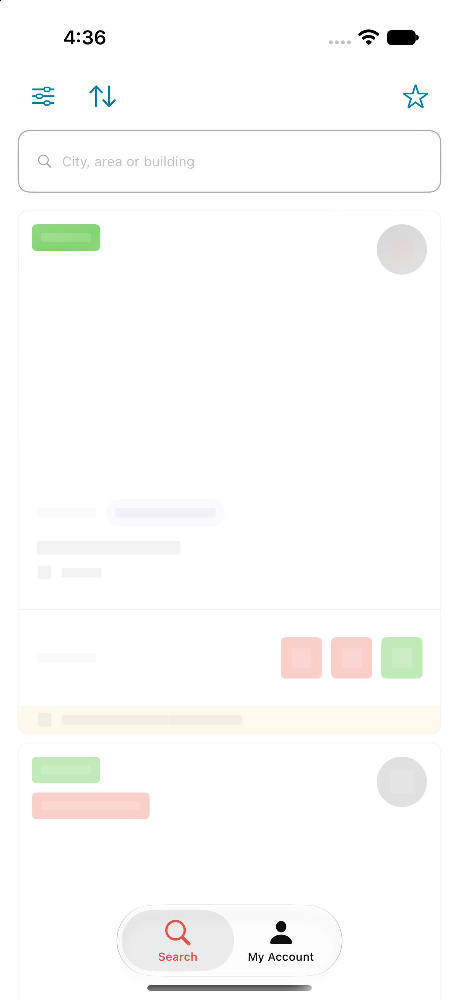 | 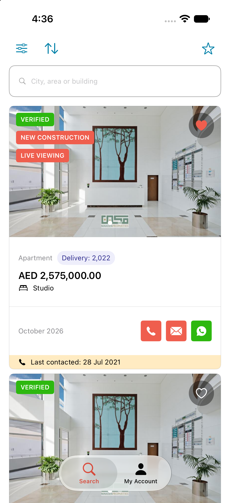 | 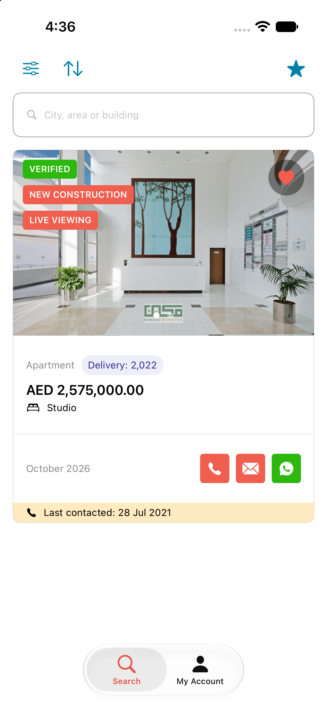 | 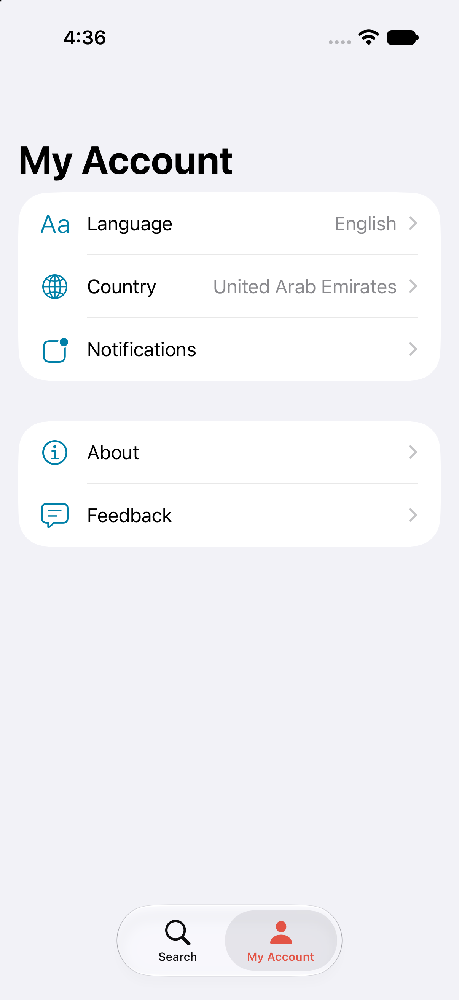 |

| **No Favorites** | **Empty** | **Service Unavailable** | **No Connection** |
| ---------------- | --------- | ----------------------- | ----------------- |
| 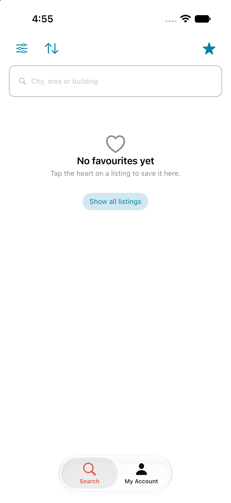 | 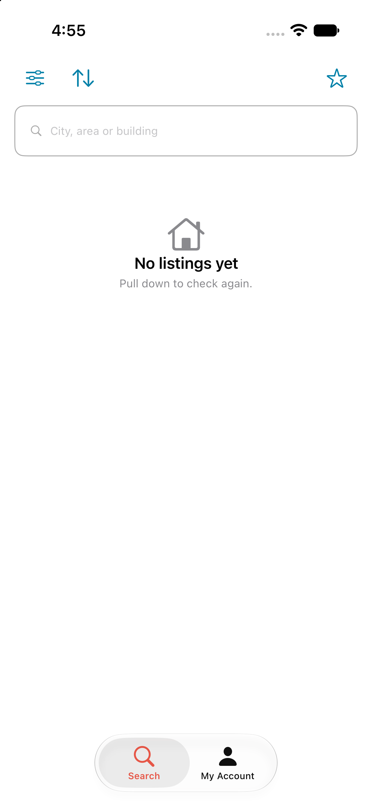 | 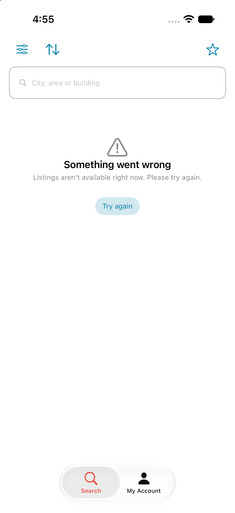 | 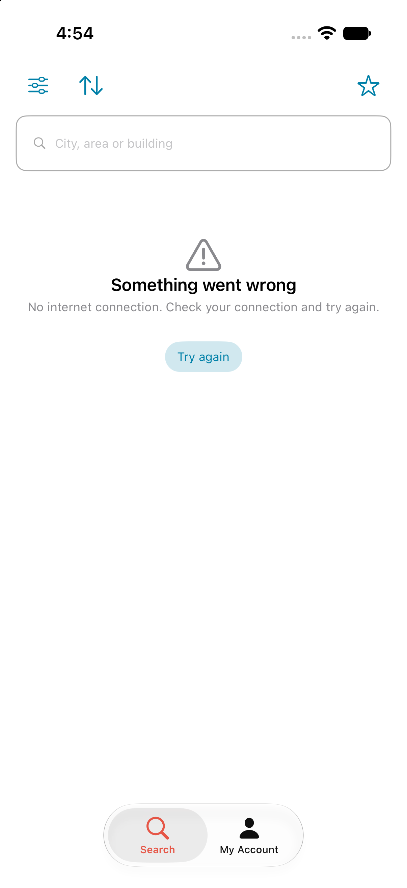 |

<br>

## 🌟 Features
* Fetching property listings from a remote JSON endpoint and rendering them as cards
* Swiping through each listing's images in a paged media carousel
* Showing listing tags (verified, new construction, live viewing, ...) as colored badges
* Displaying studios and bedroom counts, delivery year, price, and currency for each listing
* Showing a relative "published" date and a "last contacted" banner only when the listing has one
* Showing only the contact buttons each listing supports (phone, email, WhatsApp)
* Favoriting listings from the heart button and persisting them locally across launches
* Filtering the list down to favorites from the header, with the star icon reflecting the filter state
* Guiding the user with a dedicated empty state when the favorites filter has nothing to show
* Handling all view states: loading (shimmer placeholders), loaded, empty, and error
* Pulling to refresh, and retrying a failed request directly from the error view
* Mapping transport errors into typed, user-facing messages (no internet, service unavailable)
* Keeping the list scrolling beneath a pinned search header
* Hosting a UIKit `UITableViewController` settings screen inside the SwiftUI tab view
* Performing async networking with `URLSession` and HTTP status validation
* Abstracting requests behind a reusable `Endpoint` protocol with headers and query parameters
* Mapping API responses into domain entities through a shared `Domainable` protocol
* Wiring each feature's dependencies through its own factory with constructor injection
* Injecting the base domain from an `.xcconfig` file instead of hardcoding it

<br>

## 🧩 Diagrams

> These diagrams were generated using Claude AI.

#### 🔻 High-Level Diagram
How the packages depend on each other.

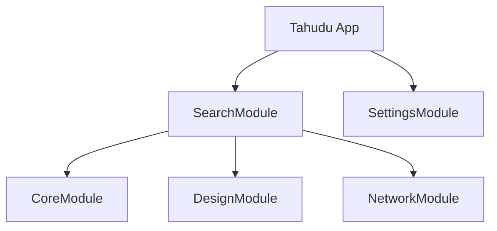

#### 🔻 Clean Architecture Diagram
How the layers are arranged inside a feature module.

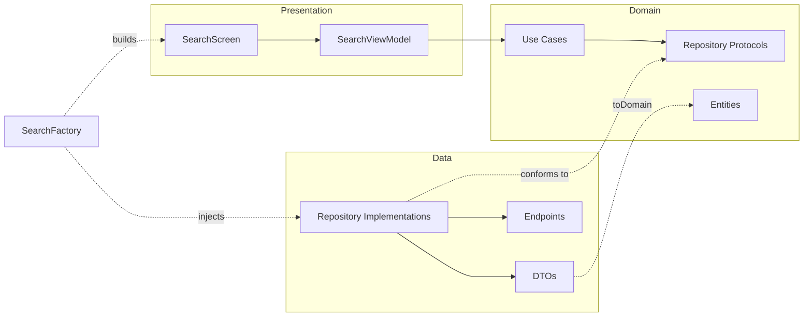

#### 🔻 Request Flow Diagram
The flow at runtime while loading the listings, and what type the value carries in between.

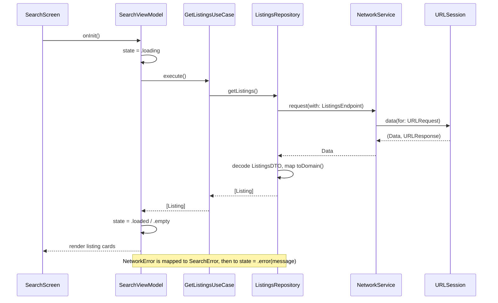

<br>

## 🗂️ Modules
**`CoreModule:`**
Responsible for containing shared abstractions and utilities used across multiple modules, such as the base view model and view state contracts, the `Domainable` mapping protocol, and Foundation and SwiftUI extensions.

**`NetworkModule:`**
Responsible for handling all networking operations, such as building URL requests from endpoints, sending them, validating responses, and mapping transport failures into typed errors.

**`DesignModule:`**
Responsible for hosting the shared design resources, such as the color palette, the carousel images, and the custom WhatsApp symbols.

**`Feature Modules:`**
Each module represents a distinct feature in the app and follows a consistent structure based on Clean Architecture principles:
  * Divided into Data, Domain, and Presentation layers.
  * Implements the MVVM (Model-View-ViewModel) design pattern.
  * Exposes a single factory that builds its screen and wires its own dependencies.
  * Built to be self-contained and modular for scalability and testability.

<br>

## 📦 Dependencies
This project uses SPM (Swift Package Manager) to split the app into local packages.
* No third-party dependencies, everything is built on Apple frameworks only.

<br>

## ☁️ API
This project fetches its listings from a JSON payload hosted on [SimpleJSONCMS](https://simplejsoncms.com).

```
GET https://simplejsoncms.com/api/m6nfoc4jlw
```

The base domain is not hardcoded, it is defined in `Config.xcconfig`, exposed through `Info.plist`, and read at runtime by the network layer.

<br>

## 🛠️ Tech Stack
* Swift 6
* SwiftUI
* UIKit
* SPM (Swift Package Manager)
* Swift Concurrency
* Combine (`ObservableObject`)
* Dependency Injection
* Modularization
* Clean Architecture
* MVVM (Model-View-ViewModel) Design Pattern
* Protocol-Oriented Programming
* URLSession
* UserDefaults
* XCConfig-Based Configuration
